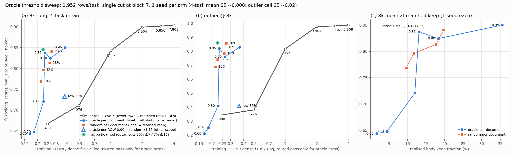

# Oracle threshold sweep

Branch `claude/oracle-thresh-sweep-69bc7d`. Follows [oracle-selection-training.md](oracle-selection-training.md)
(the 0.95 point `orc1doc`). Code and data: `research/token_routing/oracle_train/` (`launch_oracle.py` arms
`orc1doc<T>`, `orc1row90r115`, `rnd1doc<pct>`; `collect_sweep.py` → `sweep_table.json`; `make_sweep_fig.py` →
`sweep_pareto.png`; `sweep_meta.jsonl` = per-run training metadata).

## Verdict

**The attribution oracle is not a better token selector than uniform random once the budget is matched, and it
gets worse as the threshold drops.** Single seed per arm throughout; the 4-task 8k mean has eval SE ≈ ±0.008, and
the two random controls 2 points of keep apart (17.7% / 19.7%) differ by 0.028 at 8k and −0.025 at 2k, so treat
seed-to-seed variation as roughly ±0.03 per arm.

- **~18% keep: tie.** Oracle 0.90 (18.3%) 0.824 vs random 17.7% 0.813 and random 19.7% 0.841 (1 seed each; gaps
  +0.011 / −0.017, inside seed noise). Outlier 0.760 vs 0.783 / 0.857.
- **~12% keep: random wins by 0.075.** Oracle 0.80 (12.0%) 0.721 vs random 11.7% 0.796 (1 seed each), almost all on
  outlier (0.409 vs 0.740, eval SE ±0.02 per cell) plus contradiction (0.898 vs 0.931). The 0.85 arm (13.1%) scores
  0.837 (outlier 0.820), so the oracle curve is not monotone in keep; with one seed, 0.85 vs 0.80 (+0.116, mostly
  outlier) is too large to be eval noise but may be a seed effect.
- **Below 5% keep the oracle sits on the dense matched-FLOP line, not above it**: 0.70 (4.5%) 0.648 and 0.60 (1.7%)
  0.643 vs dense f488 0.667 at 0.25x and these arms at 0.18x / 0.17x (FTM ≤1.34x / ≤1.47x, upper bounds).
- **Nothing here beats the recipe** (learned router, two cuts, 0.846 at 0.226x, FTM 4.60x). The best oracle arm is
  0.85 at FTM 4.16x (best-case per-step speedup 4.28x, routed pass only); the random controls give 3.16x–3.64x.
- **Same eval path.** The 0.90 and 0.80 arms were re-scored on the local slurm path that scored the random controls;
  the 16 cells agree with their Lambda scores within 0.004 except 0.90 outlier@2k (−0.009, SE ±0.02); 8k means move
  0.823 → 0.824 and 0.721 → 0.721. The table uses the local-path scores for both.

**Why: within each document the oracle keeps the wrong tokens.** Per-document allocation fixes how many tokens each
document keeps, so oracle and random agree on everything except *which* tokens: no document is ever emptied (0.000
for every per-doc arm), and gold documents get exactly their body share (oracle 0.90 outlier: 5.2% of kept tokens
in gold docs vs 5.2% of body tokens). What differs is position: the oracle concentrates its picks at each
document's start, more so as the threshold drops (outlier, share of kept tokens among each document's first 8 body
tokens: 0.95 → 15%, 0.90 → 27%, 0.85 → 35%, 0.80 → 31%, 0.70 → 55%, 0.60 → 71%; uniform random 5%; first fifth of
the document 37% → 83% vs 20%). Outlier (spot the off-topic documents) needs content from across each document, which
uniform sampling covers and a head-heavy pick does not. At the same time the oracle's routed train CE falls far
below dense at low thresholds (0.80: 0.152 vs 0.211; 0.70: 0.150 vs 0.240; 0.60: 0.160 vs 0.241), while random
arms train at 0.20–0.23 routed CE: the label-aware pick makes the training loss easy without transferring to
held-out rows, the same leak the 11-04 per-row arms showed, now inside each document instead of across them.

## Setup

- Qwen3.5-4B (marker-fixed base), 4-task CTC fast8k mix (contradiction / nq / outlier / oolong), fresh pool,
  **1,952 rows/task = 488 steps**, global batch 16, seq 12,288, LR 1e-5, seed 0. Recipe base
  `lora64all32r20to7` with a **single cut at block 7** (`--st-otr-stages` removed), per-document allocation
  (`--st-otr-doc-share 1.0`).
- **Oracle arms** (`--st-otr-score oracle --oracle-scope doc --oracle-target T`): each step runs dense pass A,
  attribution pass B, picks per document the smallest grid fraction k whose body-view attribution cos ≥ T, and
  trains on routed pass C. T ∈ {0.95 (existing `orc1doc`), 0.90, 0.85, 0.80, 0.70, 0.60}.
- **Per-row arm** `orc1row90r115` (a different scope): per-ROW oracle at T = 0.90 plus random body tokens
  = 1.15 × the row's oracle count (`--oracle-random-mult 1.15`), single cut at block 7. Target ≈ 30% total.
- **Random controls** (`--st-otr-score random --st-otr-keep-frac X`, per-document, single cut at block 7): set
  from the oracle arms' REALISED full-run mean keep (per-doc rounding adds ~0.01 to the nominal X). Two early
  controls (nominal 0.19 / 0.09) were sized from the step-~225 means; the 0.80 arm kept rising after that, so
  two better-matched controls (0.17 / 0.11) were added. All four are on the figure.
- **Dense below f1952**: dense at 488 and 976 rows/task (LR 5e-6, the dense curve's LR), to put dense at matched
  total FLOPs next to the routed arms.
- **Evals**: 4 tasks × {8k, 2k}, eval_size 500 per cell, no-cot, query after, docchunk ladder / dense emitter.
  Binomial SE per cell ±0.007–0.021 (±0.021 at f1 ≈ 0.70, ±0.010 at 0.95); the 4-task mean has SE ≈ ±0.008.
  **Each arm is 1 seed**, so run-to-run variation adds to this.
- **Meters**: step cost = `flop_meter/actual_pflops` of the run / dense f1952's (1,531 PF). For oracle arms
  this counts the routed pass only (the hub's accounting), i.e. the best-case per-step cost of a selector that
  knew the oracle set for free. FTM = dense PF needed to reach the arm's 8k mean (log-linear along the fresh
  dense curve 488 → 7,808 rows/task) / the arm's PF; `<=` = below the lowest dense point.

## Where it ran

All Beaker copies sat pending on jupiter for 4–7 h (congestion, not the spec); every arm trained on a local
copy instead and its Beaker twin was cancelled unstarted.

| arm | copy | node |
|---|---|---|
| 0.90 / 0.85 / 0.80 / per-row | `-lam` | Lambda hyperplane02, 2× A100 each |
| 0.70 / 0.60, dense f488 / f976, 4 random controls | `-cub` | cubbins, 2× H200 each (random at `--qos=preemptive`) |

## Results

Step cost = run PF / dense f1952 PF (1,531); for oracle arms the meter counts the routed pass only, so it is the
best-case per-step cost of a selector that knew the oracle set for free (passes A and B are not charged).
Best-case speedup = 1 / step cost. FTM = dense PF needed for the arm's 8k mean (log-linear along the dense curve) /
the arm's PF; `<=` = below dense f488, the lowest dense point. eval_size 500 per cell, no-cot, f1 (oolong: score);
binomial SE ±0.007–0.022 per cell, ≈ ±0.008 for the 4-task mean. **Every arm is 1 seed.** Keep = realised mean
body keep at the cut (quarters q1→q4). Grad cos = routed-vs-dense gradient cosine (LoRA, raw / Adam-preconditioned),
logged by the oracle step; random and recipe arms do not compute it. Train CE: oracle arms log dense and routed CE
on the same batch every step (full-run mean); random / recipe arms log only their routed CE.

| arm | eval path | keep (q1→q4 %) | step cost | best-case speedup | grad cos raw / Adam | train CE dense → routed | 8k contra / nq / outlier / oolong | **8k mean** | 2k mean | PF | FTM (8k) |
|---|---|---|---|---|---|---|---|---|---|---|---|
| dense f488 (LR 5e-6) | local slurm | 100% | 0.25 | 1.0x | - | - | - | **0.667** | 0.805 | 379 | 1.0x |
| dense f976 (LR 5e-6) | local slurm | 100% | 0.50 | 1.0x | - | - | - | **0.712** | 0.816 | 762 | 1.0x |
| dense f1952 (LR 5e-6) | Beaker | 100% | 1.00 | 1.0x | - | - | - | **0.843** | 0.933 | 1531 | 1.0x |
| dense f3904 (LR 5e-6) | Beaker | 100% | 2.00 | 1.0x | - | - | - | **0.899** | 0.953 | 3063 | 1.0x |
| dense f5856 (LR 5e-6) | Beaker | 100% | 3.00 | 1.0x | - | - | - | **0.901** | 0.955 | 4595 | 1.0x |
| dense f7808 (LR 5e-6) | Beaker | 100% | 4.00 | 1.0x | - | - | - | **0.904** | 0.958 | 6128 | 1.0x |
| oracle doc 0.95 (`orc1doc`, 11-04) | Beaker | 35.5% (39/39/34/30) | 0.365 | 2.74x | 0.58 / 0.66 | 0.148 → 0.151 | 0.973 / 0.930 / 0.828 / 0.669 | **0.850** | 0.902 | 559 | 3.00x |
| oracle doc 0.90 | local slurm (re-score of the Lambda copy) | 18.3% (19/21/17/16) | 0.264 | 3.79x | 0.44 / 0.53 | 0.160 → 0.157 | 0.957 / 0.924 / 0.760 / 0.656 | **0.824** | 0.882 | 404 | 3.44x |
| oracle doc 0.85 | Lambda | 13.1% (11/15/14/13) | 0.234 | 4.28x | 0.36 / 0.45 | 0.164 → 0.155 | 0.959 / 0.936 / 0.820 / 0.633 | **0.837** | 0.871 | 358 | 4.16x |
| oracle doc 0.80 | local slurm (re-score of the Lambda copy) | 12.0% (6/11/15/16) | 0.227 | 4.40x | 0.29 / 0.35 | 0.211 → 0.152 | 0.898 / 0.932 / 0.409 / 0.644 | **0.721** | 0.808 | 348 | 2.30x |
| oracle doc 0.70 | local slurm | 4.5% (2/5/5/6) | 0.184 | 5.43x | 0.23 / 0.29 | 0.240 → 0.150 | 0.820 / 0.916 / 0.254 / 0.601 | **0.648** | 0.770 | 282 | <=1.34x |
| oracle doc 0.60 | local slurm | 1.7% (1/2/2/2) | 0.168 | 5.94x | 0.23 / 0.29 | 0.241 → 0.160 | 0.861 / 0.922 / 0.210 / 0.581 | **0.643** | 0.750 | 258 | <=1.47x |
| oracle ROW 0.90 + random x1.15 (other scope) | Lambda | 34.8% (29/29/32/49) | 0.362 | 2.76x | 0.45 / 0.47 | 0.184 → 0.106 | 0.958 / 0.916 / 0.408 / 0.651 | **0.733** | 0.826 | 554 | 1.54x |
| random doc, nominal 19% | local slurm | 19.7% (20/20/20/20) | 0.272 | 3.68x | - | - → 0.202 | 0.945 / 0.926 / 0.857 / 0.634 | **0.841** | 0.885 | 416 | 3.64x |
| random doc, nominal 17% | local slurm | 17.7% (18/18/18/18) | 0.260 | 3.84x | - | - → 0.226 | 0.928 / 0.904 / 0.783 / 0.637 | **0.813** | 0.911 | 398 | 3.29x |
| random doc, nominal 11% | local slurm | 11.7% (12/12/12/12) | 0.225 | 4.43x | - | - → 0.228 | 0.931 / 0.878 / 0.740 / 0.637 | **0.796** | 0.895 | 345 | 3.47x |
| random doc, nominal 9% | local slurm | 9.7% (10/10/10/10) | 0.214 | 4.67x | - | - → 0.232 | 0.915 / 0.862 / 0.689 / 0.609 | **0.769** | 0.868 | 328 | 3.16x |
| recipe `lora64all32r20to7` (router, 2 cuts) | Beaker | 20.5% (21/21/21/21) | 0.226 | 4.43x | - | - → 0.176 | 0.960 / 0.912 / 0.860 / 0.650 | **0.846** | 0.921 | 345 | 4.60x |

Dense f488 / f976 per task (8k): contradiction 0.888 / 0.951, nq 0.896 / 0.916, outlier 0.344 / 0.380, oolong
0.541 / 0.599.

### Random controls: which oracle arm each one matches

| random control | realised keep | matched oracle arm (realised keep) | 8k mean: random vs oracle (gap, 1 seed each) | outlier@8k |
|---|---|---|---|---|
| nominal 17% (`rnd1doc17`) | 17.7% | 0.90 (18.3%), closest match | 0.813 vs 0.824 (−0.011) | 0.783 vs 0.760 |
| nominal 19% (`rnd1doc19`) | 19.7% | 0.90 (18.3%), first control, sized from the step-225 mean | 0.841 vs 0.824 (+0.017) | 0.857 vs 0.760 |
| nominal 11% (`rnd1doc11`) | 11.7% | 0.80 (12.0%), closest match | 0.796 vs 0.721 (+0.075) | 0.740 vs 0.409 |
| nominal 9% (`rnd1doc9`) | 9.7% | 0.80 (12.0%), first control, sized from the step-225 projection | 0.769 vs 0.721 (+0.048) | 0.689 vs 0.409 |

The 0.80 arm's keep kept rising after step 225 (6% → 16% by quarter; full mean 12.0%), so the first control (9.7%)
undershot; the 0.90 arm's keep fell late (19 → 16%), so the first control (19.7%) overshot. The 17% and 11% controls
were launched against the final full-run means.

### Where the selected tokens sit (oracle vs random at matched keep)

From the saved selections (`oracle_meta/sel`, every 2nd saved step, 244 steps; `sel_stats.py`, outputs in
`research/token_routing/oracle_train/sel_stats/`). Random per-document controls are uniform within each document
by construction: zero-kept documents 0, kept-in-gold = gold share of body, 20% of picks per fifth of the document,
first-8 share as in the "uniform" column.

| arm (keep) | task | zero-kept docs | kept tokens in gold docs (gold share of body) | first 8 tokens of each doc (uniform) | position fifths 1→5 |
|---|---|---|---|---|---|
| 0.95 (35%) | outlier | 0.000 | n/a (run predates the gold sidecar) | 0.147 (0.054) | .37/.19/.15/.13/.16 |
| 0.90 (18%) | outlier | 0.000 | 0.052 (0.052) | 0.269 (0.054) | .49/.16/.12/.10/.13 |
| 0.85 (13%) | outlier | 0.000 | 0.052 (0.052) | 0.350 (0.054) | .54/.14/.10/.09/.12 |
| 0.80 (12%) | outlier | 0.000 | 0.052 (0.052) | 0.306 (0.054) | .47/.15/.13/.12/.14 |
| 0.70 (4.5%) | outlier | 0.000 | 0.052 (0.052) | 0.549 (0.054) | .72/.09/.06/.06/.07 |
| 0.60 (1.7%) | outlier | 0.000 | 0.053 (0.052) | 0.707 (0.054) | .83/.05/.04/.03/.04 |
| 0.90 (18%) | nq | 0.000 | 0.021 (0.021) | 0.240 (0.051) | .59/.16/.10/.08/.08 |
| 0.90 (18%) | contradiction | 0.000 | 0.033 (0.033) | 0.376 (0.193) | .42/.18/.13/.10/.17 |
| 0.90 (18%) | oolong | 0.000 | (no gold) | 0.156 (0.150) | .26/.20/.15/.18/.21 |
| row 0.90 oracle part (16%) | outlier | 0.033 | 0.166 (0.052) | 0.185 (0.055) | .36/.18/.15/.15/.17 |
| row 0.90 oracle part (16%) | contradiction | 0.254 | 0.173 (0.033) | 0.310 (0.208) | .33/.19/.16/.15/.17 |

Per-doc oracle arms: gold keep = distractor keep in every task (e.g. 0.90 outlier 0.174 / 0.174), so there is no
gold leak through allocation; the head bias is the only placement difference from random, and it is strongest on
the retrieval-style tasks (nq, outlier) and weakest on oolong, whose documents are short.

### Per-row oracle + random arm (`orc1row90r115`, a different scope)

Per-ROW oracle at attribution-cos 0.90 plus random body tokens = 1.15 × the row's oracle count, one cut at block 7.

- Realised shares (full run): oracle 16.2% of body, random 18.6%, total 34.8%. The total rose late (29/29/32/49% by
  quarter; oracle part 14/13/15/23%), so it ended well above the ~30% aimed for.
- Leak test (gold sidecar on): gold-document keep 0.774 vs distractor 0.334 for the total; 0.717 vs 0.145 for the
  oracle part alone. The random part lands in gold documents rarely (0.5–2.6% of its tokens) because the oracle has
  already taken most gold tokens.
- Empty documents: 17.5% of documents get no oracle token; with the random tokens 0.5% stay empty.
- Train CE dense 0.184 → routed 0.106 (quarters routed .205/.097/.066/.057 vs dense .291/.184/.142/.119): routed
  below dense all run, the leak signature. Routed-vs-dense grad cos 0.45 (Adam 0.47).
- 8k 0.733 (outlier 0.408) at step cost 0.362 (FTM 1.54x): the random tokens do not repair the per-row leak.
- 11-04 per-row references from the saved Beaker metadata: `orc1row` (0.95, no random; Beaker copy steps 1–198)
  gold keep 0.835 vs distractor 0.260, 6.1% empty docs, routed CE 0.160 vs dense 0.234; `orc1batchr2` (batch scope +
  random ×2) gold 0.582 vs distractor 0.292, 31% empty docs, routed CE 0.149 vs dense 0.147.

Figure `research/token_routing/oracle_train/sweep_pareto.png`: (a) 8k mean and (b) outlier@8k vs training FLOPs /
dense f1952 (log x; `flop_meter/actual_pflops`, routed pass only for the oracle arms), with the dense curve 488 →
7,808 rows/task as the matched-total-FLOPs reference, the oracle per-document curve (labels = target), random
per-document controls (labels = realised keep), the recipe, and the per-row arm as its own marker; (c) 8k mean vs
realised keep, oracle vs random.

## Training-side metadata

Keep drifts with training at a fixed threshold, in both directions: 0.80 rose 6 → 16% across quarters, 0.70
2 → 6%, 0.60 1 → 2%, 0.85 11 → 13%, while 0.90 fell 21 → 16% and 0.95 39 → 30%. The attribution cos achieved at the
chosen k (body view) averaged 0.911 / 0.864 / 0.820 / 0.720 / 0.631 for targets 0.90 / 0.85 / 0.80 / 0.70 / 0.60, so
0.70 and 0.60 run at the target, not at the grid floor (their early steps sat at k = 0.0005, about one token per
document). Routed-vs-dense LoRA grad cos falls with the threshold: 0.58 (0.95), 0.44, 0.36, 0.29, 0.23, 0.23.

Estimated vs realised keep (estimates from the task brief): 0.90 19% → 18.3%; 0.85 11% → 13.1%; 0.80 7% → 12.0%;
0.70 3% → 4.5%; 0.60 ~1% → 1.7%. Step-cost estimates (0.18 + 0.55 × keep) vs metered: 0.90 0.28 → 0.264; 0.85 0.24
→ 0.234; 0.80 0.22 → 0.227; 0.70 0.20 → 0.184; 0.60 0.185 → 0.168.

## Anomalies and caveats

- **No empty generations, no parse failures**: every cell has 500 responses, none empty (checked on the 12 new
  runs' first-pass evals). Oolong answers are category words, which is expected.
- **Shared Lambda eval runner picked the wrong checkpoint** (fixed in 836ae96a8): `run_eval_lambda.sbatch` took the
  highest-sorting `model_and_optim` dir, which with `--ephemeral-save-interval` is a `stepN` resume point with no
  `config.json`, so every eval died in 22 s. Now only dirs with a `config.json` qualify. Any session evaluating
  resume-every runs on Lambda with an older copy of the runner hits this.
- **No preemptions or restarts** in any training run: no log has a "Will resume training" line and every run logged
  steps 1–488 once (the "No checkpoint found" line appears twice per run, at start-up, before step 1).
- **Beaker**: none of the 8 Beaker training twins or 24 Beaker eval twins ever scheduled on jupiter (4–7 h pending at
  urgent); all were cancelled unstarted once the local copy finished.
- **Lambda** hyperplane02: the four 2-GPU copies took the node from czye's 8-GPU `normal` job, which was preempted.
- **Eval paths differ by arm**: dense f1952+, recipe and 0.95 on Beaker; 0.85 and the per-row arm on Lambda; everything
  else on the local slurm path (parity with Beaker within 0.002 per cell on the recipe checkpoint, see
  `records/f8k-local-slurm-eval.md`); the 0.90 / 0.80 Lambda-vs-local re-score agrees within 0.004 (one cell 0.009).
- **Lambda result rows have no git commit** (`provenance gap` warnings in `ops result add --check`): the Lambda runner
  does not record it. The Lambda code copy was staged from this branch around f112fc74f (`$L/oracle/code`).
- **The 0.95 point is from 11-04** (`orc1doc`, Beaker) and has no gold sidecar, so its gold columns are blank.

## Files

- Training metadata (METAJSON / FLOPJSON / LOGJSON per run): `research/token_routing/oracle_train/sweep_meta.jsonl`.
- Table: `sweep_table.json`; figure: `sweep_pareto.png` (same folder).
- Checkpoints: model-only copies on S3 `ai2-llm/checkpoints/prasanns/_transfer/oracle/runs/<run>`; cubbins runs
  also at `cubbins:/data/prasann/oracle/runs/<run>` (with resume checkpoints); Lambda runs at
  `lambda-hyperplane02:/tmp/prasann/oracle/runs/<run>`; dense f488/f976 and 0.70 / 0.60 / random also on weka
  `ctc_suite/ckpts/<run>`.
- Eval outputs: Lambda arms in `research/token_routing/oracle_train/results_lam/<run>/` (gitignored, kept) and
  `$L/eval_results/<run>/` on Lambda; cubbins arms in `<node>:/data/prasann/f8k_eval/runs/<run>/eval/`.
